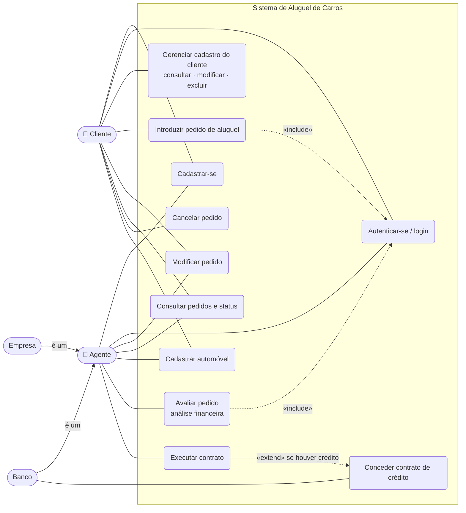

# Diagrama de Casos de Uso

## Descrição resumida

| Caso de uso | Ator | Regra principal |
|---|---|---|
| Cadastrar-se | Cliente, Agente | Usuário único; cliente informa RG, CPF, nome, endereço, profissão e até 3 rendimentos |
| Autenticar-se | Todos | Sistema só é usado após login (usuário e senha) |
| Gerenciar cadastro | Cliente | Consulta, altera e exclui o próprio cadastro |
| Introduzir pedido | Cliente | Pedido nasce **EM_ANALISE** |
| Modificar pedido | Cliente / Agente | Cliente: só em análise. Agente: enquanto não encerrado |
| Cancelar pedido | Cliente | Não cancela pedido com contrato executado |
| Avaliar pedido | Agente | Parecer financeiro positivo ou negativo |
| Executar contrato | Agente | Exige parecer positivo; define quem é dono do automóvel |
| Conceder crédito | Banco | Somente se o pedido solicitou crédito |
