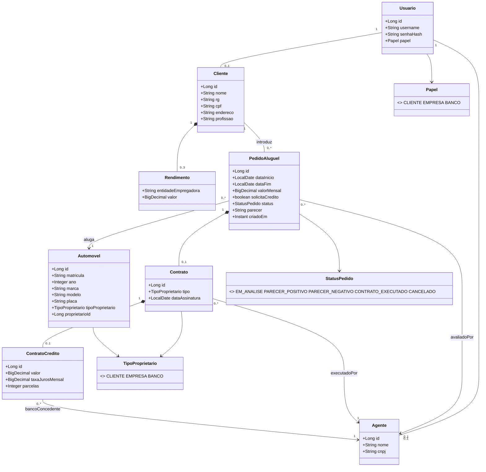

# Diagrama de Classes (modelo de domínio)

**Observação:** `Automovel.proprietarioId` é uma referência polimórfica (id de `Cliente` ou `Agente`,
conforme `tipoProprietario`). Ela é atualizada quando um contrato é executado.
