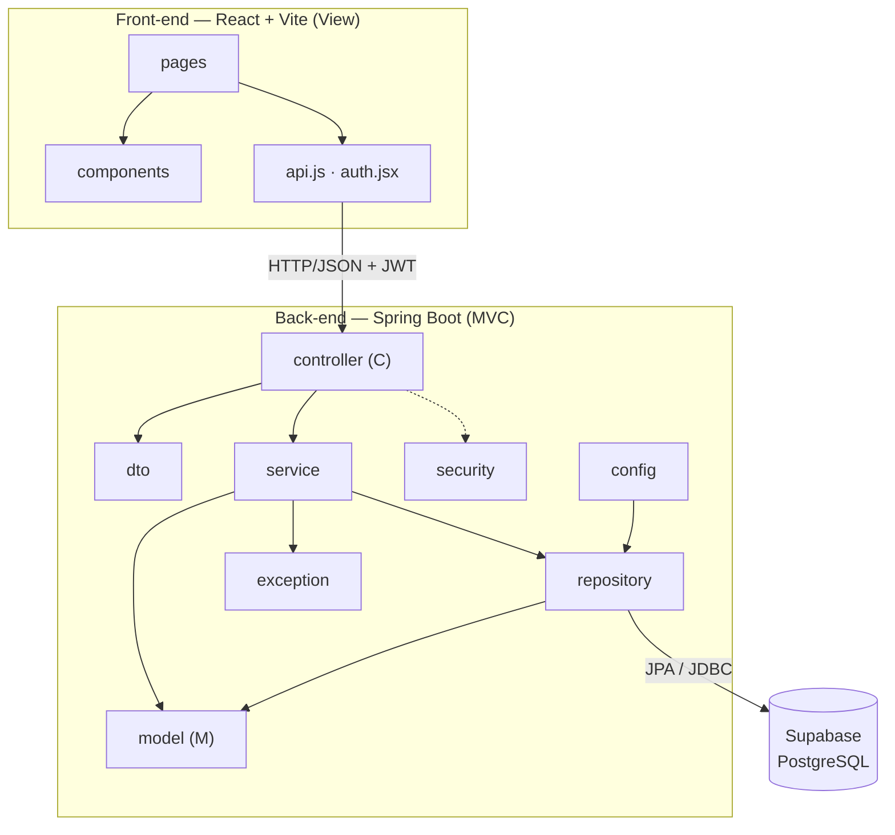

# Diagrama de Pacotes (Visão Lógica)

## Subsistemas citados no enunciado

| Subsistema | Pacotes |
|---|---|
| Gestão de pedidos e contratos | `service`, `repository`, `model`, `controller` |
| Construção dinâmica das páginas web | Front-end React (`pages`, `components`) |
